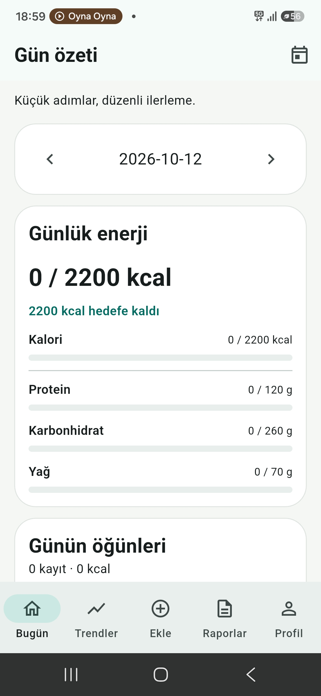
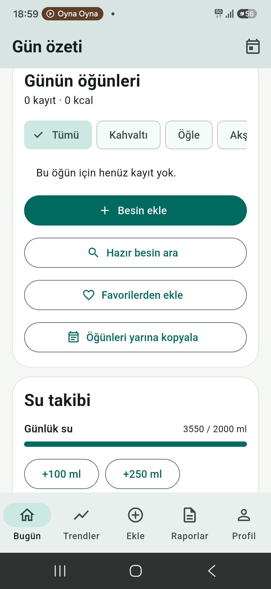
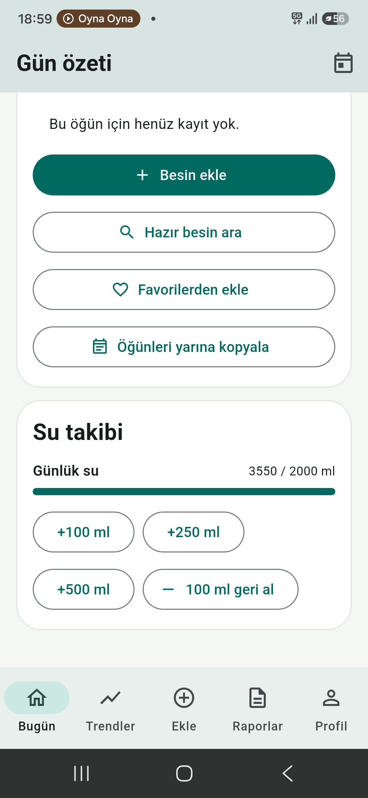
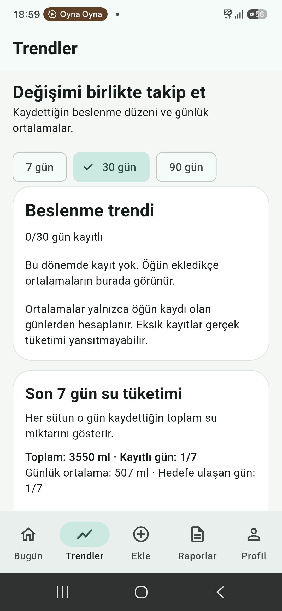
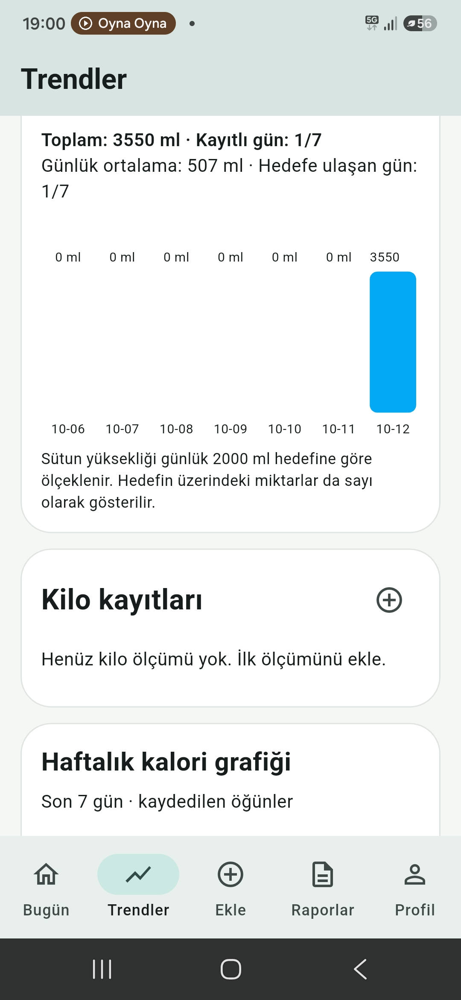
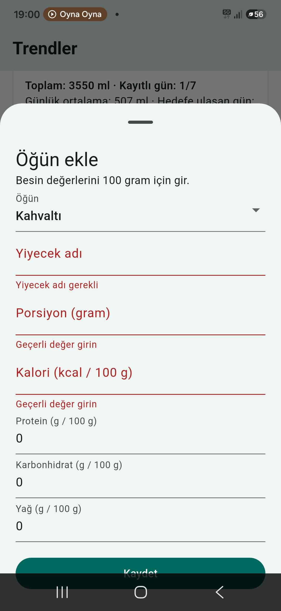
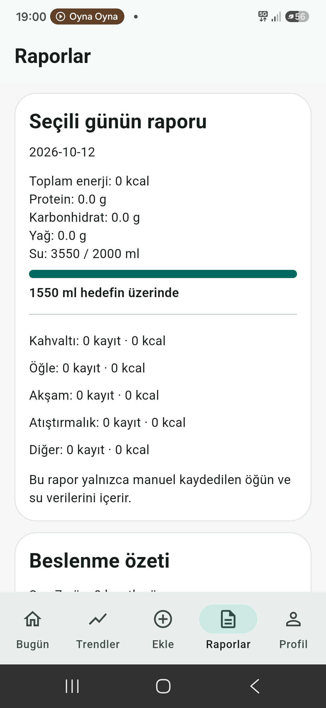
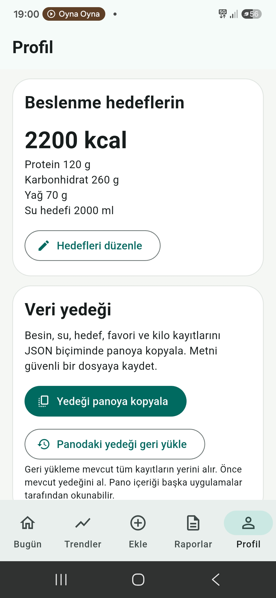

# PaketKap | Flutter & Dart

**PaketKap**, Türkçe arayüzlü, çevrimdışı çalışan Android kalori ve beslenme takip uygulamasıdır. Flutter, Dart, Material 3 ve SQLite ile geliştirilmiştir.

[](https://github.com/alidanis61615/PaketKap/actions/workflows/flutter-checks.yml)

**Hızlı bağlantılar:** [Teknik portföy özeti](docs/PORTFOLIO_OVERVIEW.md) · [Ekran görüntüsü ve yayın kontrol listesi](docs/PORTFOLIO_CHECKLIST.md) · [Otomatik testler ve APK](https://github.com/alidanis61615/PaketKap/actions)

> **Portföy demosu:** Gün Özeti ekranında bir besin ekleyin; ardından su takibini ve Trendler ekranındaki 7 günlük grafikleri inceleyin. Uygulama internetsiz çalışır. Gerçek cihaz ekran görüntüleri henüz depoya eklenmedi.

## Uygulama ekranları

Gerçek Android cihazından alınan ekran görüntüleri, uygulamanın temel akışlarını gösterir. Görseller depoya eklendiğinde bu bölümde yan yana sergilenecektir.

| Ekran | Gösterilen özellik |
| --- | --- |
| Gün Özeti | Günlük kalori ve makro hedefleri |
| Öğün ve Su Takibi | Besin ekleme, favoriler, su miktarı düzenleme |
| Trendler | 7/30/90 günlük dönemler, su tüketim grafiği ve kilo kayıtları |
| Besin Ekleme | Porsiyon ve 100 g başına besin değeri girişi, form doğrulama |
| Raporlar | Günlük kalori, makro, öğün ve su özeti |
| Profil | Hedefleri düzenleme ve JSON veri yedeği |

> **Görsel hazırlığı:** Bu bölüme ait gerçek cihaz ekran görüntüleri toplandı; GitHub deposuna görsel dosyaları henüz yüklenmedi. Yüklendiğinde galeri bağlantıları eklenecektir.

## Özellikler
- **Gün özeti:** Kalori, protein, karbonhidrat ve yağ hedefleri; kalan kalori bilgisi.
- **Öğün takibi:** Besin ekleme, düzenleme, silme; kahvaltı/öğle/akşam/atıştırmalık kategorileri.
- **Besin kataloğu ve favoriler:** Örnek besinlerden hızlı ekleme; gram ve 100 gramlık değerleri düzenleme.
- **Su takibi:** Günlük içilen suyu kaydetme.
- **Trendler:** 7/30/90 günlük beslenme ortalamaları, son 7 gün kalori ve su grafikleri, su istatistikleri, kilo ölçümleri ve kilo grafiği.
- **Raporlar:** Günlük ve haftalık özetler, su hedefi ilerlemesi ve hedefe yakın günler.
- **Profil:** Kalori, makro ve günlük su hedeflerini düzenleme.
- **Yerel yedek:** Besin, su, kilo, favori ve hedefleri JSON biçiminde panoya kopyalama; panodan geri yükleme. Geri yükleme mevcut kayıtların **tamamını değiştirir** ve onay ister.

Besin değerleri elle girilir; katalogdaki değerler yaklaşık örneklerdir. Uygulama tıbbi tavsiye sunmaz.

## Teknolojiler
- Flutter / Dart / Material 3
- SQLite (`sqflite`) ve `path`
- Flutter testleri ve GitHub Actions (analiz, test, debug APK)

## Portföyde öne çıkan teknik noktalar
- Günlük verileri SQLite ile kalıcı saklama ve veritabanı sürüm geçişleri.
- Besinlerin enerji ve makro hesaplamalarını porsiyon gramına göre yapma.
- JSON yedek içeriğini kontrol edip geri yüklemeyi veritabanı işlemi (transaction) içinde gerçekleştirme.
- GitHub Actions ile statik analiz, otomatik test ve Android debug APK üretimi.

> **İsimlendirme notu:** GitHub deposu ve kullanıcıya görünen marka adı PaketKap'tır. Flutter proje kimliği (`kalori_hesaplayici`) mevcut Android uygulama kimliğiyle uyumluluğu korumak için değiştirilmemiştir.

## Yerelde çalıştırma
Flutter SDK ve Android geliştirme araçları gerekir.

```bash
git clone https://github.com/alidanis61615/PaketKap.git
cd PaketKap
flutter create --platforms=android --project-name kalori_hesaplayici .
flutter pub get
flutter run
```

## Android APK
**Actions → Flutter checks / Build Android APK → başarılı çalışma → Artifacts** bölümünden `kalori-hesaplayici-debug-apk` dosyasını indirin. Bu bir **debug** derlemesidir; mağaza yayınına hazır imzalı sürüm değildir.

## Test
```bash
flutter analyze --no-fatal-infos
flutter test
flutter build apk --debug
```

## Veri güvenliği
Kayıtlar varsayılan olarak cihazdaki SQLite veritabanında tutulur; bulut eşitleme yoktur. JSON yedeği panoya kopyalanır; panodaki içerik diğer uygulamalar tarafından okunabilir. Yedeği güvenli bir yerde saklayın. Geri yükleme mevcut kayıtları silip yedektekilerle değiştirir. Güncelleme öncesi uygulamayı kaldırmayın.

## Bilinen sınırlar
- Fotoğraftan otomatik besin analizi, barkod tarama, Health Connect ve bulut senkronizasyonu bulunmaz.
- Kalori ve kilo grafikleri yalnızca kullanıcı tarafından girilen verileri gösterir.
- Su hedefi örnek bir değerdir; kişiye özel sağlık önerisi değildir.
- Android sürümleri ve farklı ekran boyutlarında ek testler yapılmalıdır.

## Uygulamadan ekran görüntüleri

Aşağıdaki görüntüler uygulamanın Android cihazda çalışan sürümünden alınmıştır. Görüntülerin üzerine basarak büyütebilirsiniz.

<p align="center">
<a href="Screenshot_20261012_185949.jpg"></a>
<a href="Screenshot_20261012_185953.jpg"></a>
<a href="Screenshot_20261012_185955.jpg"></a>
<a href="Screenshot_20261012_185959.jpg"></a>
<a href="Screenshot_20261012_190002.jpg"></a>
<a href="Screenshot_20261012_190006.jpg"></a>
<a href="Screenshot_20261012_190013.jpg"></a>
<a href="Screenshot_20261012_190016.jpg"></a>
</p>

**Gösterilen ekranlar:** Gün özeti, öğün ekleme, su takibi, 7/30/90 günlük trendler, su grafiği, besin ekleme formu, günlük raporlar ve profil/veri yedeği.

> **Demo notu:** Bazı ekranlarda henüz besin kaydı bulunmadığından sıfır değerler ve boş durum mesajları gösterilir. Görseller gerçek uygulama ekranlarıdır; temsili mockup değildir.

## Proje durumu
Portföy geliştirmeleri test edilerek Pull Request #1 üzerinden `main` dalına birleştirildi. Uygulama Android cihazda manuel olarak da denendi. Ekran görüntüsü dosyalarının GitHub deposuna yüklenmesi henüz tamamlanmadı.

**Geliştirme amacı:** Flutter/Dart, yerel veri saklama, kullanıcı arayüzü, hata ayıklama ve CI/CD becerilerini uygulamalı bir portföy projesinde göstermek.
